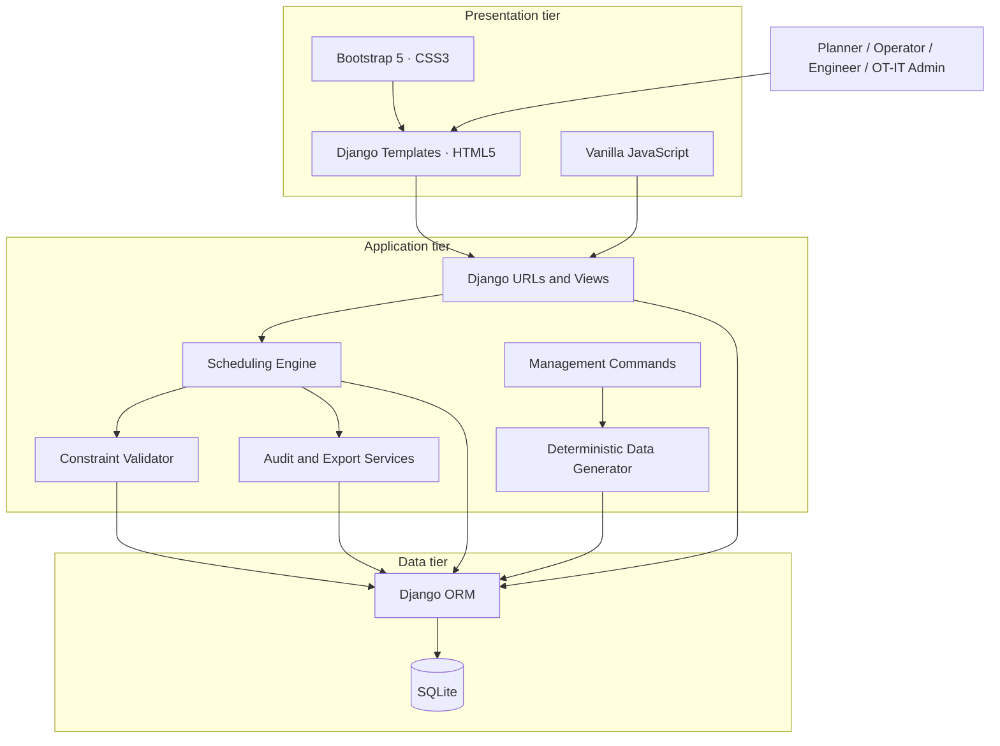
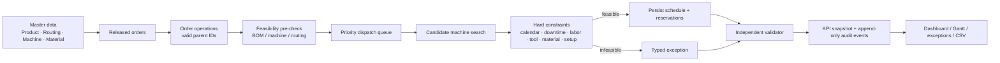
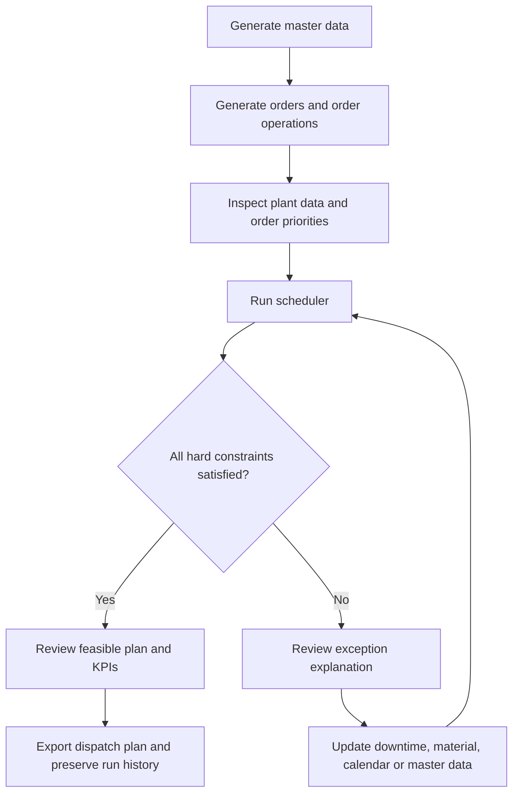

# Architecture and workflow

## Three-tier architecture

## Scheduling data flow

## User workflow

## Scheduling decision sequence

1. Sort released orders by priority ascending (1 is highest), due date ascending and immutable order ID.
2. Calculate each order's material requirement from the product BOM and order quantity. Determine the earliest lot-availability timestamp where all required quantities can be covered.
3. For each route operation in sequence, evaluate only machines linked through `OperationEligibleMachine`.
4. Reject a candidate when machine tooling is missing, no active calendar exists, the job plus setup exceeds shift capacity, downtime overlaps, labor capacity is exceeded, tooling is already occupied, or a changeover matrix entry is absent.
5. Choose the feasible candidate with the earliest finish; break ties by start time and machine ID.
6. Append the job to that machine's queue. Record setup and processing separately.
7. Reserve the order's BOM quantities from eligible lots FIFO when its first operation is assigned.
8. Independently re-check persisted assignments and append any detected exception records.
9. Compute metrics from source and schedule rows, then append a run-completed audit event.

## Cardinality overview

- Product 1:N Routing; Routing 1:N RoutingStep.
- Product N:M Material through ProductMaterial (BOM).
- RoutingStep N:M Machine through RoutingStepMachine.
- ProductionOrder N:1 Product and N:1 Routing; ProductionOrder 1:N Operation.
- Operation N:M Machine through OperationEligibleMachine.
- Machine 1:N MachineCalendar and MachineDowntime.
- Material 1:N InventoryLot.
- Machine N:M Tooling through MachineTooling; RoutingStep optionally N:1 Tooling.
- Machine 1:N ChangeoverMatrix rows (each row defines a from-setup/to-setup pair).
- SchedulingRun 1:N OperationSchedule, MaterialReservation and ScheduleException.
- Operation 1:N OperationSchedule across runs; within one run it can be scheduled at most once.
- OperationSchedule N:1 Machine and N:1 Operation.
- AuditEvent is append-only and references source entities by stable entity type/ID to preserve historical records without destructive updates.

## API surface

| Method | Path | Behavior |
|---|---|---|
| GET | `/api/metrics/` | Latest completed run KPI snapshot and exception count |
| GET | `/api/orders/` | First 100 released orders, ordered by priority and due date |
| POST | `/run/` | Execute a scheduling run (CSRF protected form) |
| GET | `/schedule/` | Query schedule rows and a simple timeline view |
| GET | `/exceptions/` | Filter exceptions by run and issue type |
| GET | `/exports/schedule.csv` | Export schedule ledger |
| GET | `/exports/exceptions.csv` | Export exception ledger |
